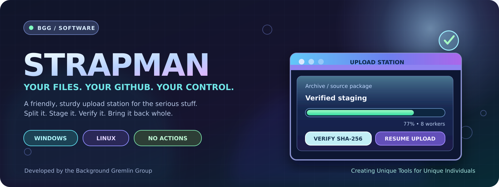
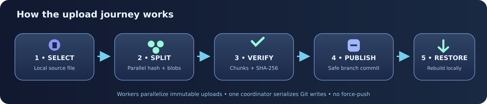

# Strapman

**Your files. Your GitHub. Your control.**

*Local-first, integrity-verified file transfers and reconstruction for developers, creators, and AI coding agents.*

**[Get Started](#get-started) · [Choose Your Edition](#three-ways-to-run-strapman) · [How It Works](#verified-transfer--rebuild) · [Report an Issue](https://github.com/bggg-gizmo/strapman/issues/new) · [Discussions](https://github.com/bggg-gizmo/strapman/discussions) · [Pull Requests](https://github.com/bggg-gizmo/strapman/pulls)**

**Background Gremlin Group**  
*Creating Unique Tools for Unique Individuals*

---

## Why Strapman?

Big files, unreliable connections, interrupted uploads, and limited CI budgets shouldn't make managing a Git repository feel like a second job.

**Strapman does the heavy lifting on your machine.** It splits large files into GitHub-compatible parts, uploads them with configurable workers, commits verified chunks and a reconstruction manifest, and rebuilds an identical local copy—without requiring GitHub Actions, paid runners, or hosted build jobs.

The same engine powers its desktop editions and its headless interface for scripts and AI coding agents. GitHub storage/API limits and network connectivity still apply.

## Three ways to run Strapman

<table>
<tr>
<td align="center" width="33%"><h3><a href="lite/README.md">Strapman Lite</a></h3><strong>The classic</strong></td>
<td align="center" width="34%"><h3><a href="bootlegger/README.md">Bootlegger Pro</a></h3><strong>More personality</strong></td>
<td align="center" width="33%"><h3><a href="docs/HEADLESS.md">Headless Strapman</a></h3><strong>Built for automation</strong></td>
</tr>
<tr>
<td valign="top">Retro desktop interface, GitHub repository management, verified uploads and rebuilds, recovery, and native notification tones.</td>
<td valign="top">Everything in Lite, with Purple Night, Pink Pearl, and Blue Frost themes, a custom icon, and <strong>16 optional MP3 voice announcements</strong>.</td>
<td valign="top">Sound-free CLI for developers, scripts, ChatGPT, Codex, and other agents, with JSON status, safe resume, builds, and a local progress dashboard.</td>
</tr>
</table>

All three share the verified transfer engine. Headless does not require the desktop audio stack for ordinary commands. [Compare the editions](docs/EDITIONS.md).

## Verified transfer & rebuild

A standard upload is an **end-to-end automated workflow**, not an upload that leaves you to figure out reconstruction afterward.

| Stage | What happens |
|:--|:--|
| **Prepare** | Choose your account, GitHub repository, branch, source file, and upload strategy. Available staging space is checked first. |
| **Stage & split** | Generate sized parts, SHA-256 checksums, and a durable checkpoint. |
| **Transfer** | Upload chunks using configurable parallel workers; branch commits are serialized without force pushes. |
| **Verify** | Confirm the parts are attached to the intended branch and validate the published manifest and checksums. |
| **Automatically rebuild** | Download the committed chunks, reconstruct the original **locally**, and confirm its full SHA-256. |
| **Complete or recover** | Show the verified output location. On interruption, preserve the original, committed data, and checkpoint for explicit Resume. |

The automatic rebuilt file can be opened from Upload Station. **Jobs & Rebuild** remains available when you need a separate manual restore. Advanced users can explicitly choose publish-only behavior.

**Important:** GitHub's ordinary Git file-size limit still applies to individual committed files. Strapman stores the chunks and manifest in the repository; a large final file is reconstructed on your local machine, not assembled by a GitHub-hosted runner.

### More than transfers

- **Repository Desk:** Browse repositories and branches, create or edit README files, manage supported repository settings, and commit source edits with SHA conflict protection.
- **Built-in code workbench:** Inspect, diff, and validate local or GitHub text files; run user-approved local tests.
- **Safe recovery:** Pause jobs gracefully, inspect saved work after an unexpected exit, and explicitly resume without repeating already-verified remote commits.
- **Audio with control:** Bootlegger voice previews and separate Sound/Voice toggles; Lite's system tones; zero audio in Headless.
- **Agent visibility:** Headless JSON status, loopback-only dashboard, and optional progress snapshots.
- **No surprise cleanup:** Originals are never automatically deleted, reclaimed, or overwritten.

## Get started

**Requirements:** Windows or Linux and Python 3.10 or later. Download/extract the **complete source ZIP** so the launchers, artwork, and Bootlegger MP3 files stay together.

| Edition | Windows launcher | Linux launcher |
|:--|:--|:--|
| **Lite** | <code>lite\Strapman-Lite.cmd</code> | <code>./lite/Strapman-Lite.sh</code> |
| **Bootlegger Pro** | <code>bootlegger\Bootlegger-Pro.cmd</code> | <code>./bootlegger/Bootlegger-Pro.sh</code> |
| **Headless** | <code>headless\headless-strapman.cmd status</code> | <code>./headless/headless-strapman.sh status</code> |

The desktop installer checks free space and reuses a compatible local Python environment when available. Headless's non-visual commands avoid installing desktop/audio dependencies.

GitHub CLI is **not mandatory**. Supported existing credentials can be reused; secure token options are available. Standalone device-code login requires the project's publisher OAuth client ID to be registered and configured.

For complete commands and agent integration, see the [Headless guide](docs/HEADLESS.md).

## Help shape Strapman

**Bug reports, ideas, testing notes, thoughtful feedback, and code contributions are welcome.** Whether you use Lite, Bootlegger, or Headless, your input helps improve reliability and usability.

- **[Submit an issue](https://github.com/bggg-gizmo/strapman/issues/new):** Report reproducible bugs or request specific features. Include the edition, operating system, steps, expected behavior, and actual result.
- **[Join a discussion](https://github.com/bggg-gizmo/strapman/discussions):** Share ideas, propose improvements, ask questions, and help decide what comes next.
- **[Create a pull request](https://github.com/bggg-gizmo/strapman/compare):** Work in a separate branch, explain the change and how you tested it, then open a PR for review. Existing features and data-integrity safeguards should remain intact. Follow our [contributing guide](CONTRIBUTING.md), including the contributor attribution chain.
- **[Review the roadmap](ROADMAP.md):** GitHub is supported now. Platform integrations are actively being developed for Gitea and Forgejo, but are not yet available in this testing build. Tell us what integrations you need in Discussions.

For code contributions, run the applicable tests before opening a PR. **Never paste access tokens, private repositories, local paths, or unredacted logs into an issue, discussion, or PR.** Report suspected security vulnerabilities through a private maintainer contact channel rather than publicly disclosing secrets.

## Testing & project status

**[Public testing checklist: What to test, how to report results, and the v1.0 release gates](docs/PUBLIC_TESTING_CHECKLIST.md)**

**v0.5.2-dev — public testing.** The documented complete-checkout review reports **122 passing Python tests**, **32/32 verified Bootlegger MP3 copies**, and a successful disposable-repository multipart upload/pause/resume/rebuild round-trip. Work remains on larger transfers, Windows/Linux GUI and speaker acceptance, reboot recovery, and publisher OAuth setup.

From the repository root, with the appropriate test dependencies installed:

    python -m pytest -q
    python tools/public_audit.py
    python tools/verify_audio_assets.py

A full Git checkout can also run <code>python tools/public_audit.py --history</code> to inspect reachable history. These checks do not replace real-device testing or guarantee that a project has no defects.

The repository is **public for testing and open source** under the [GNU GPL version 3 or later](LICENSE), with an [attribution-chain NOTICE](NOTICE) and [credits record](ATTRIBUTION.md). **If you fork or distribute modifications, preserve existing credits and add your name or handle, date, and change summary.** Original media are licensed to the extent their creators have the necessary rights; third-party trademarks, likeness rights and dependencies are not automatically granted by this repository.

## Documentation

| Guide | What you'll find |
|:--|:--|
| [License & attribution chain](LICENSE) | GNU GPLv3+, [mandatory notices](NOTICE), [credits](ATTRIBUTION.md), and [contributor guide](CONTRIBUTING.md) |
| [Public testing checklist](docs/PUBLIC_TESTING_CHECKLIST.md) | Real-world test cases, required evidence, v1.0 release gates |
| [User manual](docs/USERMAN.md) | Setup, upload, verification, reconstruction, and daily use |
| [Headless reference](docs/HEADLESS.md) | CLI commands, agent workflows, JSON status, dashboards |
| [Workflow contract](docs/WORKFLOW.md) | Automatic build/rebuild, pause, resume, completion states |
| [Bootlegger Pro](bootlegger/README.md) | Themes, icons, voice events, and settings |
| [Project specification](SPECS.md) | Complete feature and implementation contract |
| [Roadmap](ROADMAP.md) | Provider support and longer-term direction |
| [Security & privacy](docs/SECURITY.md) | Credentials, source auditing, and responsible reporting |
| [Release readiness](docs/RELEASE_READINESS.md) | Completed tests and outstanding acceptance gates |

---

**Built by Background Gremlin Group**

*Creating Unique Tools for Unique Individuals*

**[Issues](https://github.com/bggg-gizmo/strapman/issues) · [Discussions](https://github.com/bggg-gizmo/strapman/discussions) · [Pull Requests](https://github.com/bggg-gizmo/strapman/pulls) · [Roadmap](ROADMAP.md)**

